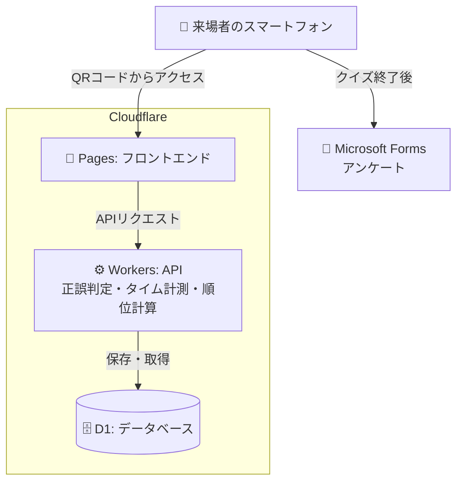
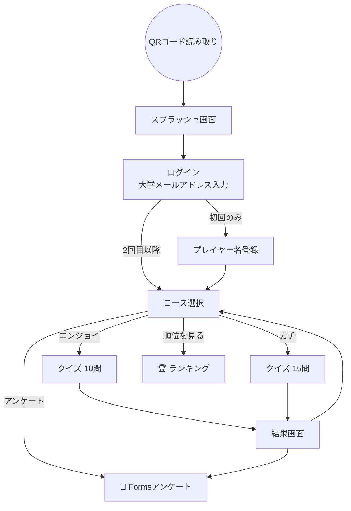
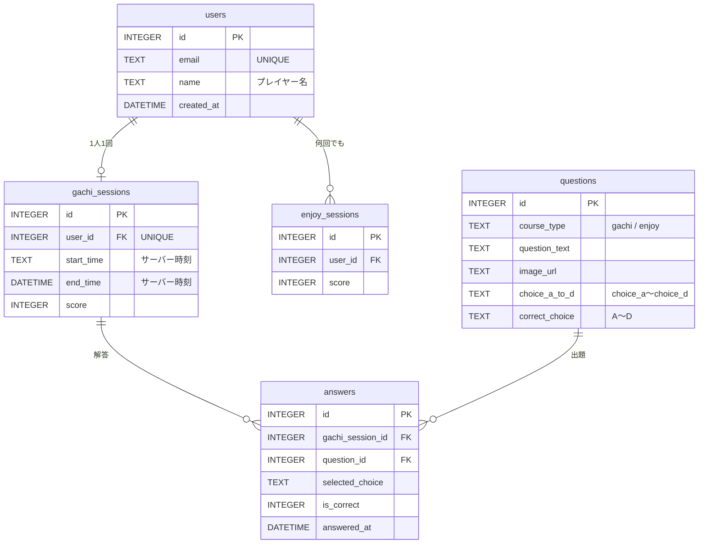

# BEETLE STATION クイズ大会サイト

カブトムシ・クワガタムシ展示会「**BEETLE STATION**（共同むしの会）」の目玉企画として実施したクイズ大会を、スマートフォンで参加できるようにしたWebアプリケーションです。

金沢工業大学の学内インターンシップ制度で勤務している「学生ステーション」が企画・運営したイベント向けに開発しました。会場に掲示したQRコードから来場者がアクセスし、その場でクイズに挑戦します。

作成者: 
昆野 和也（Kazuya Konno） / 金沢工業大学 情報理工学部 情報工学科
椎谷 善輝（Zenki Shiya） / 金沢工業大学 情報理工学部 情報工学科

---

## 目次

- [目的](#目的)
- [主な機能](#主な機能)
- [システム構成](#システム構成)
- [画面遷移](#画面遷移)
- [API](#api)
- [データベース設計](#データベース設計)
- [不正対策の設計](#不正対策の設計)
- [要件定義からの変更点](#要件定義からの変更点)
- [今後の改善点](#今後の改善点)
- [ディレクトリ構成](#ディレクトリ構成)
- [ローカルでの動かし方](#ローカルでの動かし方)

---

## 目的

| 目的 | 内容 |
|---|---|
| 愛好家同士の交流 | スコアやマニアックな問題をきっかけに、カブトムシ・クワガタムシ好きの来場者同士の会話を生む |
| イベントの盛り上げ | 紙ではなくスマホで、その場ですぐに参加・結果確認ができるクイズ大会にする |
| 大学の活性化 | 来場者の満足度を高め、大学の認知度向上や地域との連携につなげる |

## 主な機能

### 2つのコース

| | エンジョイコース | ガチコース |
|---|---|---|
| 対象 | 誰でも気軽に楽しみたい人 | 賞品をかけて本気で挑戦したい人 |
| 出題数 | **10問**（画像つき問題5問＋テキスト問題5問をランダムに出題） | **15問**（30問のなかからランダムに出題） |
| 挑戦回数 | 何回でも | **1人1回まで** |
| タイム計測 | なし | **サーバー側で計測** |
| ランキング | なし | **あり**（スコア → タイムの順で順位づけ） |
| 公開 | 常時 | 解禁日時まではカウントダウンを表示 |

### そのほかの機能

- **ログイン**：大学のメールアドレスを入力してログイン。初回のみ、ランキングに表示するプレイヤー名（最大12文字）を登録
- **1画面1問のクイズ画面**：画面上部に問題文と画像、下部に4色の大きな選択肢ボタンを配置（スマホでのタップしやすさを優先）
- **結果画面**：正答数・タイム・ガチコースでの順位を表示
- **ランキング**：ガチコースの上位50位までをいつでも確認可能
- **アンケート**：クイズ終了後、Microsoft Formsのアンケートへ案内

## システム構成

Cloudflareのサーバーレス構成で、イベント当日の短時間のアクセス集中にも耐えられるようにしました。

| 層 | 技術 |
|---|---|
| フロントエンド | Vanilla JavaScript ＋ Vite（Cloudflare Pagesで配信） |
| バックエンド（API） | Cloudflare Workers |
| データベース | Cloudflare D1（SQLite互換） |
| アンケート | Microsoft Forms |



## 画面遷移



## API

すべて Cloudflare Workers（`backend/src/index.js`）で受け付けます。

| メソッド | パス | 内容 |
|---|---|---|
| GET | `/api/auth` | メールアドレスでユーザーを検索し、未登録なら新規作成する |
| POST | `/api/update-name` | プレイヤー名を登録する |
| POST | `/api/start-quiz/gachi` | 解禁日時・挑戦済みかを確認し、開始時刻を記録して15問を返す |
| POST | `/api/start-quiz/enjoy` | プレイ記録を作成して10問を返す |
| POST | `/api/submit-answer` | 1問ごとの解答を受け取り、サーバー側で正誤判定して保存する |
| POST | `/api/finish-quiz/gachi` | 終了時刻とスコアを記録し、自分の順位を返す |
| POST | `/api/finish-quiz/enjoy` | スコアを記録する |
| GET | `/api/ranking` | ガチコースのランキングを返す（初期値は上位50件） |

## データベース設計

テーブル定義は `backend/schema.sql`、問題データは `backend/seed.sql` にあります。



## 不正対策の設計

賞品がかかるガチコースでは、**結果を決める処理をすべてサーバー側に置く**ことを設計の軸にしました。

| 想定した不正 | 対策 |
|---|---|
| 端末の時刻を書き換えてタイムを短くする | 開始・終了時刻はどちらも **Workers 側で取得**し、ブラウザの時刻は使わない。画面のタイマーは表示用のみ |
| 通信の中身から正解を盗み見る | 問題を返すAPIでは **`correct_choice` を除外**して送り、正誤判定はサーバーで行う |
| 自分で点数を書き換えて送る | ガチコースのスコアはクライアントから受け取らず、**`answers` テーブルの正解数をサーバーで集計**する |
| ボタンの連打で同じ問題に何度も解答する | 同じセッション・同じ問題の解答がすでにあれば、2回目以降は保存しない |
| 何度も挑戦して良い結果だけを残す | `gachi_sessions.user_id` に **UNIQUE 制約**をかけ、1人1回に制限 |
| 解禁前にガチコースを始める | 解禁日時の判定を **サーバー側**でも行う |

## 要件定義からの変更点

開発前に作成した要件定義から、実装の段階で次の点を変更しました。

| 項目 | 要件定義 | 実装 |
|---|---|---|
| ログイン方式 | Cloudflare Zero Trust（Access）＋ 大学の Microsoft Entra ID による SSO | 大学メールアドレスの入力によるログイン |
| エンジョイコースの出題数 | 5問 | 10問（画像つき5問＋テキスト5問） |
| アンケート | D1 に `surveys` テーブルを作って保存 | Microsoft Forms に切り替え、テーブルは不要に |
| セッション管理 | `play_sessions` テーブルで両コースを管理 | `gachi_sessions` と `enjoy_sessions` に分割（タイム計測と挑戦回数の制限がガチコースだけに必要なため） |

## 今後の改善点

イベントでの運用を終えて、次に作るときに直したい点です。

- **本人確認を強くする**：現在のログインはメールアドレスの入力のみで、そのアドレスの持ち主かどうかを確認していない。要件定義どおり、Entra ID による SSO など、本人確認のできる方式に戻したい
- **APIをログイン状態と結びつける**：現在は `userId` や `sessionId` をクライアントから受け取っているため、サーバー側で発行したセッション（トークン）から利用者を特定する形にしたい
- **CORS の許可範囲を絞る**：現在は `Access-Control-Allow-Origin: *` のため、フロントエンドのドメインだけを許可したい
- **同点・同タイムの扱い**：要件定義では「先に参加した人を上位」としていたが、ランキングのSQLにはまだ反映できていない
- **テストを書く**：`backend/test/` はテンプレートのままなので、正誤判定や順位計算のテストを追加したい

## ディレクトリ構成

```
QuizCompetitionSite/
├── frontend/                 # フロントエンド（Vite）
│   ├── index.html            # スプラッシュ・ログイン・名前登録
│   ├── course.html           # コース選択
│   ├── enjoy.html            # エンジョイコース
│   ├── gachi.html            # ガチコース
│   ├── ranking.html          # ランキング
│   ├── public/               # ロゴ・問題画像・アイコン
│   └── src/
│       ├── api.js            # API呼び出しをまとめたモジュール
│       ├── main.js           # ログイン・名前登録の処理
│       ├── pages/            # 各ページの処理
│       └── css/              # 各ページのスタイル
└── backend/                  # バックエンド（Cloudflare Workers）
    ├── src/
    │   ├── index.js          # ルーティング
    │   └── handlers/         # user / session / answer / ranking
    ├── schema.sql            # テーブル定義
    ├── seed.sql              # 問題データ
    └── wrangler.jsonc        # Workers・D1 の設定
```

## ローカルでの動かし方

Node.js と npm が必要です。

```bash
# バックエンド
cd backend
npm install
npx wrangler d1 execute quiz-db --local --file=./schema.sql   # テーブル作成
npx wrangler d1 execute quiz-db --local --file=./seed.sql     # 問題データ投入
npm run dev                                                   # http://localhost:8787

# フロントエンド（別のターミナルで）
cd frontend
npm install
npm run dev
```

フロントエンドを `localhost` で開くと、API の接続先は自動で `http://localhost:8787` になります（`frontend/src/api.js`）。
